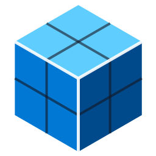

<h1 align="center">VoxToRoblox</h1>

Lleva tus personajes y equipables animados de <b>VoxEdit</b> a <b>Roblox</b> (y a Blender) con todas sus animaciones y colores. 
Dos apps sencillas para Windows — sin programar.

<a href="README.md">English</a> · <b>Español</b>

## Cómo usarla (video)

 
▶ <a href="https://youtu.be/C37fPBK0E6I">Ver el tutorial en YouTube</a>

---

## Qué necesitas

- **Windows 10 u 11**
- **[Blender](https://www.blender.org/download/)** 4.4 o superior (gratis) — solo instálalo, las apps lo encuentran solas
- **VoxEdit** y **Roblox Studio**

## Opción A — directo desde tus proyectos de VoxEdit

1. Copia las carpetas de tus proyectos de VoxEdit en **`Projects`**.
2. Abre **`Start VoxEdit Project to GLTF.exe`** (logo ámbar).
3. Desmarca en **Exportar a GLTF** lo que no quieras y presiona **Convertir**.
4. Presiona **GLTF → Roblox** para pasar al siguiente paso (Opción B, desde el paso 2).

## Opción B — desde archivos GLTF exportados por VoxEdit

1. Pon tus archivos `.gltf` / `.glb` en **`Input`**.
2. Abre **`Start VoxEdit to Roblox.exe`** (logo azul).
3. **Exportar**: desmarca lo que no quieras convertir.
4. **Equipable**: marca las piezas de equipo (casco, pecho, brazos, piernas, arma, escudo…). Las piezas marcadas de la misma carpeta forman **un kit** que comparte el cuerpo.
5. Presiona **Convertir**. Tus archivos quedan en **`Output`**.

## Importar en Roblox

1. En Roblox Studio: **Import 3D** → elige `Output\<Nombre>\<Nombre>_Roblox.fbx`.
2. Revisa que aparezcan las animaciones y presiona **Import**: el personaje queda en la escena y cada animación se sube a tu inventario.
3. Para editar el personaje en Blender, abre `<Nombre>_Rig.blend` de la misma carpeta.

## Qué hay en la carpeta

| | |
|---|---|
| `Start VoxEdit Project to GLTF.exe` | Proyectos de VoxEdit → GLTF |
| `Start VoxEdit to Roblox.exe` | GLTF → Roblox (y Blender) |
| `Projects` | Las carpetas de tus proyectos de VoxEdit |
| `Input` | Los GLTF para convertir |
| `Output` | Los resultados para Roblox y Blender |
| `app` | Las apps en sí — no hace falta tocarla |

Las carpetas `Projects`, `Input` y `Output` se crean la primera vez que abres las apps.

## Si Windows muestra un aviso

Las apps no están firmadas, así que la primera vez Windows puede decir *"Windows protegió su PC"*. Haz clic en **Más información → Ejecutar de todas formas**.

## Más información

Desarrolladores y usuarios avanzados: opciones, archivos que se generan, kits, materiales y uso desde consola están en las [notas técnicas](app/TECNICO.md).

## Agradecimientos

A [**vengi**](https://github.com/vengi-voxel/vengi), de [Martin Gerhardy (@mgerhardy)](https://github.com/mgerhardy): sus herramientas de vóxeles de código abierto documentan cómo están hechos los archivos de proyecto de VoxEdit, y eso hizo posible la app *Proyecto VoxEdit → GLTF*.

---

[Licencia MIT](LICENSE) © Ashara Studios — hecho con amor por [Ashara Studios](https://asharastudios.com). No está afiliado a The Sandbox ni a VoxEdit.
